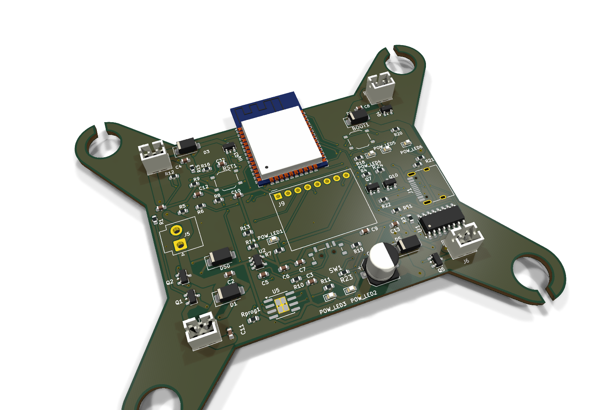
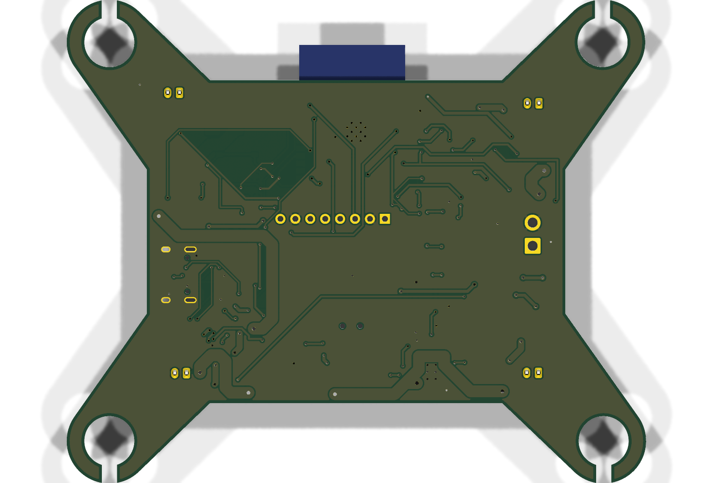
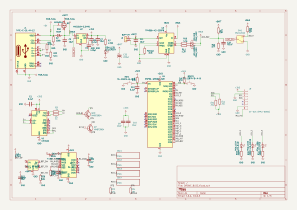
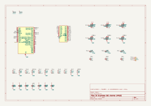

# ESP32 Quadcopter Flight Controllers

Two small flight controller boards for 1S (single-cell) quadcopters, designed in KiCad 10. The design files are kept in a private repository. You can request access below.

## Coreless (brushed) version

A 2-layer board with an ESP32 for control, a GY-521 (MPU-6050) motion sensor, a USB-C port for programming and charging, and four MOSFET drivers for coreless motors.

Bottom view

## Brushless version

The same ESP32 flight controller with four ESCs on the board for 1S brushless motors, plus an Ra-02 LoRa radio for long-range control. Schematic stage, PCB not laid out yet.

ESC schematic

## Request access to the design files

The KiCad files (schematics, PCB layout, gerbers, BOM) are in a private repository.

**[Click here to request access](https://github.com/Muhammad-Asif10710/KiCAD-Drone-Public/issues/new?template=access-request.yml)**

Fill in the short form. You will be added as a collaborator if the request is approved.
